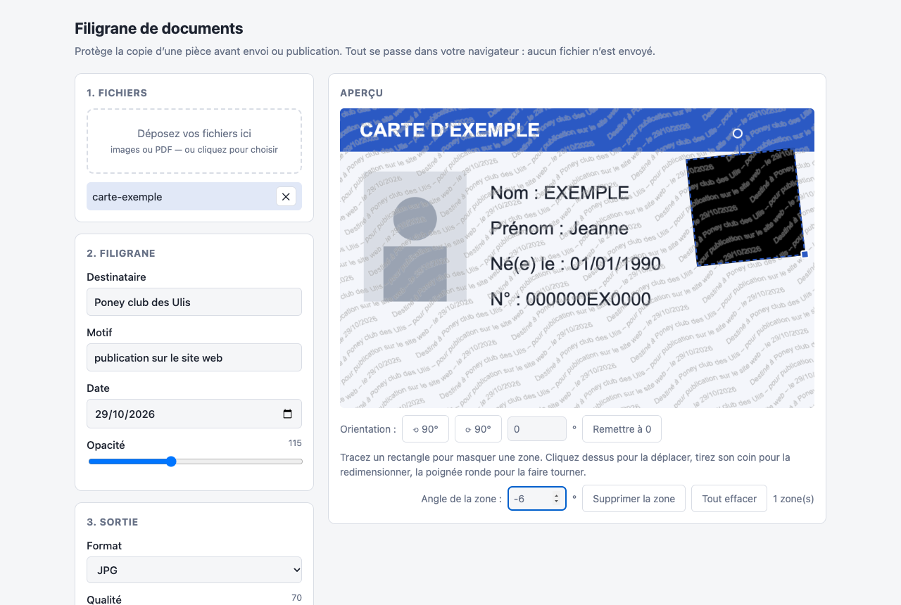

# Filigrane de documents

**[Ouvrir la page en ligne](https://vincentm498.github.io/filigrane-docs/)** — rien à installer, tout se passe dans votre navigateur.



Protège la copie d'un document (pièce d'identité, diplôme, etc.) avant envoi ou publication.

Pour chaque fichier, la page :

1. corrige l'orientation de l'image si besoin ;
2. masque les zones indiquées (aplat noir, irréversible dans le fichier exporté) ;
3. applique un filigrane en vagues, en diagonale, répété sur toute la surface :
   « Destiné à *destinataire* – pour *motif* – le *date* » ;
4. supprime les métadonnées (EXIF, etc.) : l'image est redessinée pixel par pixel ;
5. exporte en JPG, PNG, WEBP ou PDF, en résolution réduite.

> **Confidentialité.** Aucun fichier n'est envoyé : tout est traité dans le navigateur, et
> la page ne charge aucun script externe (les bibliothèques sont dans [`vendor/`](vendor/)).
> Un test automatique vérifie qu'elle n'émet aucune requête vers l'extérieur.
>
> **Limite.** Un filigrane dissuade et permet de prouver l'origine d'une copie, mais il
> n'empêche pas l'OCR ni la capture d'écran. Pour les informations inutiles au
> destinataire (numéro de carte, QR code, date de naissance…), utilisez le masquage.

## Utilisation

1. **Fichiers** : déposez vos images ou PDF dans la zone prévue, ou cliquez pour les
   choisir. Cliquez sur un fichier de la liste pour le voir dans l'aperçu. Pour un PDF de
   plusieurs pages, les boutons ◀ ▶ parcourent les pages.
2. **Filigrane** : renseignez le destinataire et le motif (obligatoires), vérifiez la
   date et réglez l'opacité. L'aperçu se met à jour en direct.
3. **Orientation (facultatif)** : sous l'aperçu, les boutons ⟲ 90° et ⟳ 90° tournent
   l'image, et le champ « ° » accepte n'importe quel angle (par exemple `2.5` pour
   redresser un scan penché ; positif = sens horaire). « Remettre à 0 » annule. La
   rotation est propre à chaque fichier et s'applique à toutes ses pages ; les coins
   libérés par une rotation oblique sont remplis de blanc.
4. **Masquage (facultatif)** : tracez un rectangle à la souris sur l'aperçu pour
   masquer une zone. Cliquez sur une zone pour la sélectionner (contour pointillé),
   puis faites-la glisser pour la déplacer, tirez la poignée carrée de son coin
   bas-droit pour la redimensionner, ou la poignée ronde au-dessus pour la faire
   tourner (Maj enfoncée : par pas de 15°). Le champ « Angle de la zone » permet de
   saisir l'angle exact en degrés. « Supprimer la zone » (ou la touche Suppr) retire
   la zone sélectionnée, « Tout effacer » les retire toutes. Les zones sont propres à
   chaque fichier et s'appliquent à toutes ses pages. Réglez l'orientation **avant** de
   tracer les zones : si vous tournez l'image ensuite, les zones restent à la même
   position à l'écran et il faut les replacer.
5. **Sortie** : choisissez le format, la qualité (JPG/WEBP) et la largeur maximale,
   puis cliquez sur **Générer**.
6. **Téléchargement** : un lien apparaît par fichier généré. S'il y en a plusieurs,
   « Tout télécharger (.zip) » les regroupe dans une seule archive. Deux fichiers de
   même nom sont numérotés (`carte_protege.jpg`, `carte_protege (2).jpg`).

### Limites

- Les formats HEIC et TIFF ne s'ouvrent que si le navigateur sait les lire (Safari
  oui, Chrome et Firefox non). Convertissez-les d'abord en JPG ou PNG.
- L'angle du filigrane est fixé à 30°.
- Un PDF est rendu à 150 dpi, une page par image : le texte du PDF d'origine n'est pas
  conservé, ce qui est voulu.

## Utiliser en local

Ouvrez `index.html` dans un navigateur (double-clic) : la page fonctionne aussi hors
ligne. Si votre navigateur bloque la lecture des PDF depuis un fichier local, servez le
dossier avec n'importe quel serveur statique, par exemple :

```bash
python3 -m http.server 8000
```

puis ouvrez <http://localhost:8000>.

## Développement

Prérequis : Node.js 20 ou plus récent.

```bash
npm install
npx playwright install chromium   # une fois ; ou PLAYWRIGHT_CHANNEL=chrome pour utiliser Chrome
npm test                          # test de fumée dans un vrai navigateur
node tests/capture.mjs            # régénère docs/apercu.png
```

Le test (`tests/smoke.mjs`) charge des images et un PDF de 2 pages, vérifie la navigation,
la rotation, le tracé d'une zone, les noms uniques, les sorties JPG et PDF, le ZIP, et
qu'il n'y a ni erreur dans la console ni requête externe.

### Déploiement

Le workflow [`.github/workflows/pages.yml`](.github/workflows/pages.yml) lance le test sur
chaque pull request et sur `main`. Sur `main`, si le test passe, il publie `index.html` et
`vendor/` sur GitHub Pages. La branche `main` est protégée : toute modification passe par
une pull request.

## Licence

[MIT](LICENSE). Les bibliothèques de [`vendor/`](vendor/README.md) gardent leur propre licence.
